# UEC Backend — Database Schema

**Audience:** backend engineers and DBAs. **Engine:** PostgreSQL 15+ (tested on 18.6). **Migrations:** `database/migrations/` (all additive).

Conventions:
- ULID string primary keys for most entities.
- Year primary keys for editions and manuals.
- `snake_case` columns and `created_at`/`updated_at` timestamps.
- Money as integer kobo.
- JSON columns are `jsonb`.
- Soft deletes only on `users`; deleted accounts are anonymised and kept so retained payment records stay valid.

## 1. Entity relationship diagram

```mermaid
erDiagram
    users ||--o{ refresh_tokens : "has sessions"
    users ||--o{ personal_access_tokens : "access tokens"
    users ||--o{ devices : "push devices"
    users ||--o{ user_activity_days : "daily activity"
    users ||--o{ favourites : ""
    users ||--o{ programs : ""
    users ||--o{ devotional_reads : "reading progress"
    users ||--o{ subscriptions : ""
    users ||--o{ payments : ""
    users ||--o{ feedback : "optional"
    users }o--o{ roles : "model_has_roles"
    roles }o--o{ permissions : "role_has_permissions"

    plans ||--o{ subscriptions : "plan_id / pending_plan_id"
    plans ||--o{ payments : ""
    subscriptions ||--o{ payments : "renewals"

    hymns }o--o{ hymn_categories : "hymn_category_hymn"
    hymns ||--o{ hymn_stanzas : ""
    hymns ||--o| hymn_solfa : ""
    hymns ||--o{ hymn_audio : ""

    devotional_editions ||--o{ devotional_entries : "edition_year"
    ss_manuals ||--o{ ss_lessons : "manual_year"
    ss_manuals ||--o{ ss_plan_weeks : "manual_year"
    ss_lessons ||--o{ ss_plan_weeks : "lesson_id (nullable)"

    bible_versions ||--o{ bible_verses : ""
    feedback ||--o{ feedback_attachments : ""
    users ||--o{ push_campaigns : "created_by"
    users ||--o{ audit_logs : "actor_id"
```

## 2. Tables

### Identity & access
| Table | Purpose | Key columns / constraints |
|---|---|---|
| `users` | Members and administrators | `id` ULID; `phone` unique (E.164); `email` unique + `LOWER(email)` unique partial index; `google_sub` unique; `password` nullable (Google-only); `*_verified_at`; `locale`; `last_seen_at`, `last_platform`, `last_app_version`; `suspended_at`; soft delete |
| `refresh_tokens` | Rotating refresh tokens (§D.1) | `token_hash` (SHA-256) unique; `family_id` (reuse revokes the family); `access_token_id`; `expires_at`, `revoked_at`, `revoked_reason`, `replaced_by_id` |
| `personal_access_tokens` | Sanctum access tokens (15 min) | `ulidMorphs(tokenable)`, `token` unique, `expires_at` |
| `roles`, `permissions`, `model_has_roles`, `role_has_permissions`, `model_has_permissions` | spatie/laravel-permission (morph key changed to ULID) | roles: member, content_editor, finance, admin, super_admin |
| `sessions` | Admin dashboard sessions (Redis in production; table kept as fallback) | |
| `devices` | FCM registrations | `token` unique; `platform`; `app_version`; index (`platform`,`app_version`) |
| `user_activity_days` | One row per user per active day (Lagos date) | unique (`user_id`,`date`); feeds DAU/WAU/MAU, retention, platform split |

### Content
| Table | Purpose | Key columns / constraints |
|---|---|---|
| `hymn_categories` | Praise, Prayer, … | `slug` unique, `sort` |
| `hymns` | Catalogue | `number` unique; `scripture_refs`, `tags` jsonb; `published_at` (visible when set and past) |
| `hymn_category_hymn` | Pivot | composite PK |
| `hymn_stanzas` | Ordered verses/choruses | unique (`hymn_id`,`position`); `lines` jsonb |
| `hymn_solfa` | One per hymn | `format` text/image; `sections` jsonb or `image_path` (private disk) |
| `hymn_audio` | Audio tracks (premium) | `storage_path` on the private disk; served via signed URLs |
| `devotional_editions` | Daily Delight yearly edition | PK `year`; `is_premium`; `published_at`; `bundle_size` |
| `devotional_entries` | One per calendar day | `date` unique; FK `edition_year` (restrict delete) |
| `devotional_reads` | Reading progress | unique (`user_id`,`entry_date`) — idempotent marks |
| `ss_manuals` | Sunday School yearly manual | PK `year` |
| `ss_lessons` | Numbered lessons | unique (`manual_year`,`number`); `outline`, `applications`, `revision_questions` jsonb |
| `ss_plan_weeks` | Weekly plan (Sundays) | unique (`manual_year`,`date`); `lesson_id` nullable (null on lesson delete) |
| `bible_versions` / `bible_verses` | Imported translations | verses PK (`version_id`,`book_id`,`chapter`,`verse`); USFM book codes |
| `events` | National calendar | `start_date` indexed; `start_time` HH:MM (Lagos) nullable = all-day |
| `branches` | Directory | trigram GIN index over name/address/city/state for `ILIKE` search |
| `pages` | About, Anthem, Doctrine, Terms, Privacy | PK `slug`; `updated_by` |

### Personal sync
| Table | Purpose | Key columns |
|---|---|---|
| `favourites` | Favourite hymns and lessons | unique (`user_id`,`favouritable_type`,`favouritable_id`) |
| `programs` | Hymn service programs | PK client UUID v4; `hymn_ids` jsonb (ordered); `updated_at` = client last-write-wins clock |

### Billing
| Table | Purpose | Key columns / constraints |
|---|---|---|
| `plans` | Monthly / 6 Months / Yearly | PK string (`plan_yearly`); `amount_kobo`; `interval_months`; `paystack_plan_code` unique |
| `subscriptions` | Lifecycle per user | `status` active/cancelled/past_due/expired; `provider_*` codes; `provider_email_token` and `authorization` **encrypted**; period dates; `pending_plan_id`; `gateway_synced_at` |
| `payments` | Every checkout and renewal | `reference` unique; `status`; `amount_kobo`; `raw` jsonb (sanitised gateway data, no card numbers); `user_id` nulled on hard delete |
| `webhook_events` | Inbound gateway events | unique (`provider`,`event_key`) = idempotency; `status` received/processed/ignored/failed |

### Platform & operations
| Table | Purpose |
|---|---|
| `app_settings` | Remote config and toggles (key → jsonb). Non-secret only. |
| `push_campaigns` | Admin/system pushes with audience filters and delivery counts |
| `notification_logs` | Per-channel delivery attempts (masked destination) |
| `audit_logs` | Admin actions, security events, gateway-driven changes (redacted properties) |
| `integration_logs` | Outbound calls: integration, operation, status, duration (no bodies) |
| `feedback`, `feedback_attachments` | Member/guest feedback and private files |
| `jobs`, `failed_jobs`, `job_batches`, `cache`, `cache_locks` | Laravel infrastructure (Redis is used for queue/cache in production) |

## 3. Data lifecycle & retention
| Data | Retention |
|---|---|
| OTP challenges | 10 min validity (record kept ≤ 70 min to answer `410`) |
| Expired access tokens | pruned daily (`uec:prune`) |
| Revoked/expired refresh tokens | pruned after 30 / 7 days |
| Abandoned checkouts | marked `abandoned` after their window |
| Integration and notification logs | 90 days (configurable `--log-days`) |
| Processed webhooks | 180 days |
| Deleted accounts | anonymised immediately; personal rows (devices, favourites, programs, progress, activity) deleted; payments kept for financial record-keeping |

## 4. Performance notes
- Every foreign key used in filters is indexed; status/date composite indexes back the admin tables and reports.
- Heavy reads (catalogue, bundles, Bible chapters) are served from Redis.
- Analytics queries aggregate in PostgreSQL (`count(*) filter (where …)`, Lagos-time date bucketing).
